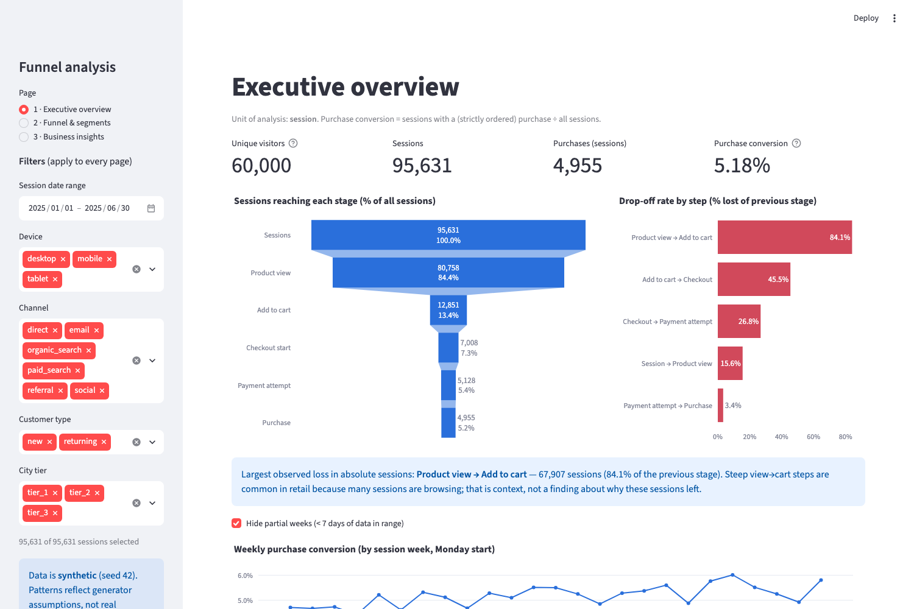
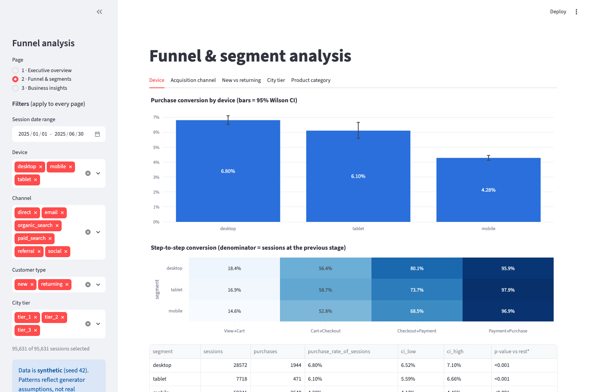
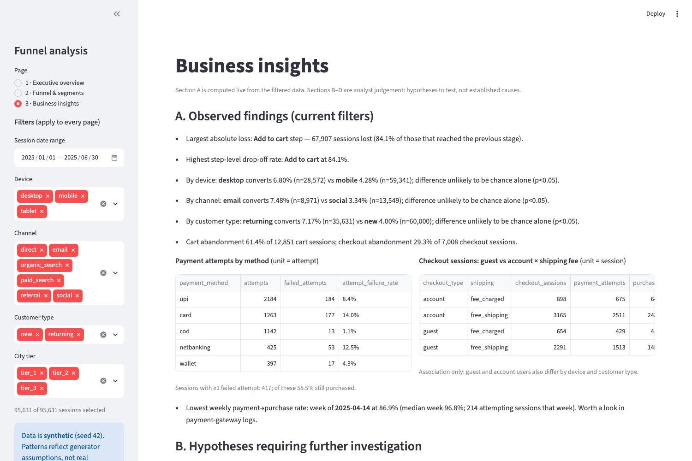

# E-commerce Conversion Funnel & Drop-off Analysis

An end-to-end product-analytics project: synthetic event data → SQL funnel metrics → independent pandas reproduction → data-quality checks → Streamlit dashboard → written business analysis.

> **Dataset disclosure:** all data is **synthetic**, generated by `src/generate_data.py` (seed 42). No public dataset was found locally and none was downloaded. Segment differences in the results reflect assumptions coded into the generator, so this project demonstrates *method and reasoning*, not discoveries about real customers. No experiment was run; no business impact is claimed.
> **AI-assistance disclosure:** the code, SQL, tests and documents were generated with Claude Code (Anthropic). The author's role is to review, run, understand and extend them.

## Business problem
An (imaginary) e-commerce platform loses many customers before purchase. Questions: where do sessions drop off, how does conversion vary by device / channel / customer type / category, do returning customers behave differently, is checkout friction associated with lower completion, and what should be investigated first?

## Objectives
Define funnel metrics with explicit denominators; reproduce them in SQL and pandas and prove they agree; validate the data without silently dropping records; separate observed findings from hypotheses; propose (not run) experiments.

## Tech stack
Python 3.14 (the only version tested) · pandas · NumPy · Matplotlib · Plotly · Streamlit · SQLite (SQL) · pytest · Jupyter (nbclient-executed). No cloud services, paid APIs or ML. Power BI is **not** used.

## Data model
`customers` 1—* `sessions` 1—* `events`; `sessions` 1—0..1 `orders` 1—* `order_items` *—1 `products`. Unit of analysis = **session** (customer-level where stated). Full keys, timestamps, anomalies and limitations: [docs/DATA_DICTIONARY.md](docs/DATA_DICTIONARY.md).

## Methodology
- **Strict chronological funnel** (`sql/01_views.sql`): a session reaches a stage only if it reached the previous one and the first timestamp of the event is not earlier. One row per session prevents double counting repeated views, retries and duplicated rows.
- Step conversion = ÷ previous stage; overall conversion = ÷ all sessions; abandonment denominators stated in each query.
- Segment comparisons use Wilson 95% intervals and two-proportion z-tests (descriptive, unadjusted for multiple comparisons).
- Injected anomalies (1,419 duplicate events, 12 purchases missing `checkout_start`) are reported by `src/validate.py`, never dropped.

## Key verified findings (synthetic data, seed 42)
| | |
|---|---|
| Sessions / visitors | 95,631 / 60,000 |
| Purchase conversion (session) | 5.18% (4,955 sessions); customer-level 7.89% |
| Largest loss | view → add-to-cart: 84.1% of viewers (67,907 sessions) |
| Cart / checkout abandonment | 61.4% / 29.3% |
| Mobile vs desktop | 4.28% vs 6.80%; checkout→payment 68.5% vs 80.1% |
| Returning vs new | 7.17% vs 4.00% |
| Payment failures | card 14.0%, UPI 8.4%, COD 1.1%; 58.5% of sessions with a failure still purchased |
| Planted incident | week of 14 Apr: payment→purchase 86.9% vs 96.8% median (the generator causes this on purpose) |

Details, caveats and hypotheses: [reports/business_report.md](reports/business_report.md).

## Dashboard screenshots
Real captures of the running app (Streamlit 1.66, headless Chromium):





## Reproduce from a fresh clone
The generated CSVs are **not committed** (git-ignored); the seeded generator recreates them byte-for-byte. Run the steps in order — validation, SQL, analysis, tests and the dashboard all read `data/raw/`.
```bash
git clone https://github.com/byomkeshkumar40/ecommerce-conversion-funnel-analysis.git && cd ecommerce-conversion-funnel-analysis
```
```bash
python3 -m venv .venv && source .venv/bin/activate
pip install -r requirements.txt
python -m src.generate_data        # REQUIRED first: writes data/raw/*.csv (~31 MB, not stored in git, deterministic)
python -m src.validate             # data-quality report -> reports/data_quality_report.md
python -m src.run_sql              # builds SQLite DB, runs sql/*.sql -> reports/sql_outputs/*.csv
python -m src.analysis             # pandas metrics, figures, reports/key_metrics.json
python -m pytest                   # 36 tests
streamlit run dashboard/app.py     # dashboard at http://localhost:8501
```
Optional (notebook, screenshots): `pip install -r requirements-optional.txt`; rebuild the notebook with `python notebooks/build_notebook.py`; re-capture screenshots with `playwright install chromium` then, with the dashboard running on port 8501, `python scripts/take_screenshots.py`. An executed copy of the notebook is included.

## Testing and validation (results of the last run)
- `pytest`: **36 passed** — known-answer tests on a hand-built dataset (double counting, out-of-order events, anomalous purchase, empty data, zero denominators), validator negative tests (duplicate keys, orphans, bad timestamps, events before session start), seeded-generation determinism, **SQL ↔ pandas reconciliation** of every query, and dashboard tests (all pages render, KPIs equal pipeline output, device filter agrees, empty filter shows a warning) using Streamlit's `AppTest`.
- `python -m src.validate`: 0 FAIL; 3 WARN, all documented injected anomalies.
- Not verified: behaviour in browsers other than headless Chromium, other Python/pandas versions, Windows paths, and PostgreSQL (SQL is SQLite dialect).

## Business recommendations (summary; hypotheses to test)
Investigate mobile checkout→payment; monitor payment-method success daily; review guest checkout; check social/paid traffic quality. Three experiment designs (hypothesis, population, primary metric, guardrails, mechanism, measurement) are in the report. None has been run.

## Limitations
Synthetic data; associations not causes; overlapping segments; shipping fee unobserved for non-checkout carts; left-censored customer type; repeat purchase is a lower bound; no real seasonality, price or inventory effects.

## Future improvements
Run on a real public dataset; joint model (logistic regression) for device × customer type × channel; cohort funnels; power calculations for experiments; Power BI view only if a real `.pbix` is built and tested.

## Structure
```
data/raw/ (generated CSVs) · data/processed/ (SQLite DB, git-ignored) · sql/ · src/ · dashboard/app.py
notebooks/ · tests/ · reports/ (business report, data-quality report, SQL outputs, figures) · docs/ · screenshots/
PROJECT_EXPLANATION.md  ← beginner walkthrough + interview questions
```
